| | |
|---|---|
| **Mata kuliah** | Big Data — Modul 6: PySpark |
| **Dosen** | Shaufiah |
| **Institusi** | Universitas Telkom |
| **Kode & notebook** | `notebooks/nyc_taxi_fare_pyspark.ipynb` (repositori `Big-Data`) |

# Ringkasan

Tugas ini membangun alur kerja *big data* dan *machine learning* end-to-end dengan **PySpark** untuk
memprediksi tarif taksi New York City dari dataset Kaggle *New York City Taxi Fare Prediction* (55.423.856 baris,
±5,3 GB CSV). Seluruh pemuatan, audit kualitas, EDA, pembersihan, dan *feature engineering* dijalankan Spark
pada **seluruh data**; hanya hasil agregasi berukuran kecil yang dibawa ke Pandas untuk visualisasi. Audit data
menemukan ±4% baris kotor (koordinat 0 atau di luar kota, tarif negatif, penumpang 0), label zona waktu yang
menyesatkan, dan kenaikan tarif resmi pada 4 September 2012. Setelah pembersihan tersisa 53.242.583 baris yang
diolah menjadi 28 fitur waktu, jarak, dan lokasi (termasuk jarak ke tiga bandara).

Empat algoritma Spark MLlib dibandingkan pada data uji 10.650.052 baris: Linear Regression (RMSE 3,81 USD),
Decision Tree (3,42), Random Forest (3,31), dan **Gradient-Boosted Trees** (3,17), jauh di atas baseline
rata-rata (9,41). GBT kemudian dituning dengan `CrossValidator` 3-fold atas 8 kombinasi hyperparameter dan
dilatih ulang dengan ±8 juta baris. **Model final mencapai RMSE 3,088 USD, MAE 1,516 USD, dan R² 0,892** pada data
uji (perbaikan RMSE 2,6% dibanding GBT awal). Seluruh notebook berjalan ±53 menit pada satu mesin 4 core.

# 1. Pendahuluan

## 1.1 Latar belakang

Taksi kuning (*yellow cab*) New York City melayani ratusan ribu perjalanan per hari. Komisi Taksi dan Limusin NYC
(TLC) mencatat setiap perjalanan, sehingga terkumpul data perjalanan berukuran puluhan juta baris per tahun.
Memperkirakan tarif **sebelum** perjalanan dimulai bermanfaat bagi penumpang (transparansi harga) maupun operator
(perencanaan armada). Tarif taksi NYC pada dasarnya ditentukan argometer — tarif awal, biaya per jarak dan per
waktu tunggu, ditambah *surcharge* malam/jam sibuk, tarif flat bandara, serta tol — sehingga seharusnya dapat
dipelajari dari lokasi jemput–antar dan waktu perjalanan.

Dengan 55 juta baris (±5,3 GB CSV), data ini sudah terlalu besar untuk diolah nyaman dengan Pandas di satu
proses: memuat seluruhnya ke memori saja membutuhkan belasan GB. Karena itu seluruh pengolahan dilakukan
dengan **Apache Spark** melalui **PySpark**: Spark SQL/DataFrame untuk ETL dan EDA, serta **MLlib** untuk
pemodelan, evaluasi dan *hyperparameter tuning*.

## 1.2 Tujuan

Sesuai lembar tugas, tujuan pekerjaan ini adalah:

1. memuat dan menyiapkan data menggunakan PySpark;
2. melakukan eksplorasi data (EDA);
3. menerapkan transformasi data (*preprocessing* dan *feature engineering*);
4. membangun model *machine learning* dengan PySpark MLlib;
5. mengevaluasi model dengan metrik yang sesuai;
6. melakukan *hyperparameter tuning* untuk meningkatkan performa model;
7. menyusun laporan (dokumen ini).

## 1.3 Rumusan masalah

Diberikan waktu penjemputan, koordinat penjemputan dan pengantaran, serta jumlah penumpang, prediksi
`fare_amount` (tarif dalam USD, termasuk tol, tidak termasuk tip). Karena target berupa bilangan kontinu,
masalah ini adalah **regresi**. Metrik utama adalah **RMSE** (*Root Mean Squared Error*) — metrik resmi
kompetisi Kaggle untuk dataset ini — didukung MAE dan R².

# 2. Dataset

| Atribut | Keterangan |
|---|---|
| Nama | *New York City Taxi Fare Prediction* (Kaggle, disponsori Google Cloud) |
| File | `train.csv` — 55.423.856 baris × 8 kolom, ±5,3 GB (CSV) |
| Salinan yang dipakai | mirror Parquet di Hugging Face `shahbajsingh/nyc-taxi-fare-prediction-train` (12 file, 3,8 GB). Jumlah baris dan kolomnya identik dengan `train.csv`; notebook juga bisa langsung membaca `train.csv` asli |
| Rentang waktu | 1 Januari 2009 – 30 Juni 2015 |
| Target | `fare_amount` (USD) |

| Kolom | Tipe | Keterangan |
|---|---|---|
| `key` | string | ID unik (timestamp + nomor urut) |
| `fare_amount` | double | **target** — tarif perjalanan |
| `pickup_datetime` | string → timestamp | waktu penjemputan |
| `pickup_longitude`, `pickup_latitude` | double | koordinat penjemputan |
| `dropoff_longitude`, `dropoff_latitude` | double | koordinat pengantaran |
| `passenger_count` | integer | jumlah penumpang (diisi pengemudi) |

File `test.csv` milik Kaggle tidak memiliki label, sehingga untuk evaluasi dibuat data uji sendiri berupa 20% data
latih yang disisihkan secara acak (*hold-out*) — sekitar 10,8 juta baris.

# 3. Lingkungan dan Arsitektur Pengolahan

| Komponen | Versi / konfigurasi |
|---|---|
| Apache Spark (PySpark) | 4.3.0, mode `local[*]` |
| Bahasa | Python 3.13, Java (OpenJDK) 21 |
| Mesin | 4 vCPU, 15 GB RAM — `spark.driver.memory = 10g`, `spark.sql.shuffle.partitions = 64`, `spark.cleaner.periodicGC.interval = 1min` |
| Pustaka pendukung | Pandas & Matplotlib (hanya untuk tabel ringkas dan grafik) |

Alur data dibuat bertahap dan setiap tahap disimpan sebagai **Parquet** (format kolumnar terkompresi):

```
train.csv / *.parquet  (55,4 juta baris)
 1. skema eksplisit, konversi tipe   -> prepared.parquet
 2. EDA: agregasi di Spark, hasil ringkas ke Pandas
 3. pembersihan, deduplikasi,
    split 80/20                      -> clean.parquet/split=train|test
    feature engineering (lazy, tidak ditulis ulang ke disk)
 4. Pipeline MLlib: VectorAssembler, OneHotEncoder,
    StandardScaler, Regressor
 5. evaluasi pada seluruh data uji
 6. CrossValidator + ParamGridBuilder
    -> model final                   -> models/gbt_tuned_final
```

Prinsip yang dipegang agar tetap *scalable*:

* **Tidak pernah memanggil `toPandas()` pada data mentah.** Yang dibawa ke driver hanya hasil agregasi (puluhan
  sampai ratusan ribu baris) atau sampel acak kecil untuk grafik.
* **Semua transformasi memakai fungsi bawaan Spark SQL** (tanpa UDF Python), sehingga dieksekusi di JVM dengan
  *whole-stage code generation*.
* **Banyak statistik dihitung dalam satu scan** — misalnya seluruh aturan anomali dihitung dalam satu `agg`, dan
  matriks korelasi 16×16 dihitung sekali jalan dengan `pyspark.ml.stat.Correlation`.
* **Parquet + partisi folder `split=train/test`** → hanya kolom & partisi yang dibutuhkan yang dibaca
  (*column pruning* dan *partition pruning*).
* Kode tidak terikat ke satu mesin: cukup ubah `SPARK_MASTER` dan ukuran sampel untuk menjalankannya di klaster.

# 4. Metodologi dan Hasil

## 4.1 Memuat dan menyiapkan data (poin 1)

1. **Pembacaan dengan skema eksplisit.** Untuk sumber CSV, skema (`StructType`) ditentukan manual agar Spark
   tidak melakukan *schema inference* yang harus membaca 5,3 GB dua kali; untuk sumber Parquet skema sudah
   tersimpan di file. Data terbaca sebagai 30 partisi sehingga diproses paralel di semua core.
2. **Konversi tipe.** `pickup_datetime` diubah dari string `"2009-06-15 17:26:21 UTC"` menjadi `timestamp`,
   `passenger_count` menjadi integer, dan kolom `key` (hanya ID) dibuang.
3. **Verifikasi zona waktu.** Walaupun berlabel `UTC`, jam di data ternyata sudah jam lokal New York. Bila jam
   dibaca apa adanya, jam tersepi adalah 05.00 dan tersibuk 19.00 — pola khas kota (dini hari sepi, puncak saat
   pulang kerja). Bila dianggap UTC lalu dikonversi ke `America/New_York`, jam tersepi bergeser ke 00.00 dan
   tersibuk ke 15.00, yang tidak masuk akal. Karena itu jam **tidak** dikonversi.
4. **Penyimpanan Parquet.** Hasilnya ditulis ke `prepared.parquet` (2,08 GB) dalam 52
   detik; seluruh tahap berikutnya membaca file ini.

## 4.2 Eksplorasi data / EDA (poin 2)

### Statistik deskriptif dan kualitas data

| Statistik | `fare_amount` | `pickup_longitude` | `pickup_latitude` | `dropoff_longitude` | `dropoff_latitude` | `passenger_count` |
|---|---:|---:|---:|---:|---:|---:|
| count | 55.423.856 | 55.423.856 | 55.423.856 | 55.423.480 | 55.423.480 | 55.423.856 |
| mean | 11,35 | −72,51 | 39,92 | −72,51 | 39,92 | 1,69 |
| stddev | 20,71 | 12,85 | 9,64 | 12,78 | 9,63 | 1,33 |
| min | −300,00 | −3.442,06 | −3.492,26 | −3.442,02 | −3.547,89 | 0 |
| 1% | 3,30 | −74,01 | 0,00 | −74,02 | 0,00 | 1 |
| 25% | 6,00 | −73,99 | 40,73 | −73,99 | 40,73 | 1 |
| 50% | 8,50 | −73,98 | 40,75 | −73,98 | 40,75 | 1 |
| 75% | 12,50 | −73,97 | 40,77 | −73,96 | 40,77 | 2 |
| 99% | 53,00 | 0,00 | 40,81 | 0,00 | 40,83 | 6 |
| max | 93.963,36 | 3.457,63 | 3.408,79 | 3.457,62 | 3.537,13 | 208 |

*Persentil dihitung dengan `approxQuantile` (algoritma Greenwald–Khanna) pada seluruh baris.*

Statistik di atas langsung memperlihatkan data kotor: tarif negatif (minimum −300 USD) dan sangat besar
(maksimum 93.963 USD), koordinat ribuan derajat (mustahil secara geografis), serta penumpang hingga
208 orang. Nilai kosong hanya ada di koordinat tujuan (376 baris). Hasil audit anomali (dihitung
dalam satu scan atas 55,4 juta baris):

| Kondisi | Jumlah baris | % dari total |
|---|---:|---:|
| ada nilai null | 376 | 0,0007 |
| `fare_amount` ≤ 0 | 3.834 | 0,0069 |
| 0 < `fare_amount` < 2,5 (di bawah tarif awal) | 913 | 0,0016 |
| `fare_amount` > 250 | 706 | 0,0013 |
| `passenger_count` = 0 | 195.416 | 0,3526 |
| `passenger_count` > 6 | 116 | 0,0002 |
| ada koordinat bernilai 0 | 1.104.490 | 1,9928 |
| pickup di luar area NYC | 1.118.248 | 2,0176 |
| dropoff di luar area NYC | 1.115.983 | 2,0135 |
| pickup = dropoff (jarak 0) | 1.581.276 | 2,8531 |

Area NYC didefinisikan sebagai kotak longitude −74,27 s.d. −72,98 dan latitude 40,50 s.d. 41,72 (lima *borough*
dan tiga bandara). Koordinat 0 menunjuk ke titik 0°, 0° di Teluk Guinea — tanda GPS tidak terbaca. Kategori di
atas saling tumpang tindih.

### Distribusi tarif


Distribusi tarif sangat menceng ke kanan: median 8,50 USD, 75% perjalanan ≤ 12,50 USD, persentil 95% 30,10 USD,
dan persentil 99% 53 USD. Pada skala log terlihat puncak-puncak tajam di sekitar 45–58 USD yang tidak mengikuti
pola menurun; ini adalah **tarif flat bandara JFK** (45 USD sebelum September 2012 dan 52 USD sesudahnya,
ditambah tol/surcharge). Puncak-puncak ini menandakan bahwa sebagian tarif ditentukan oleh **aturan**, bukan
oleh jarak, sehingga model non-linear (pohon) diperkirakan lebih cocok daripada model linear.

### Pola waktu

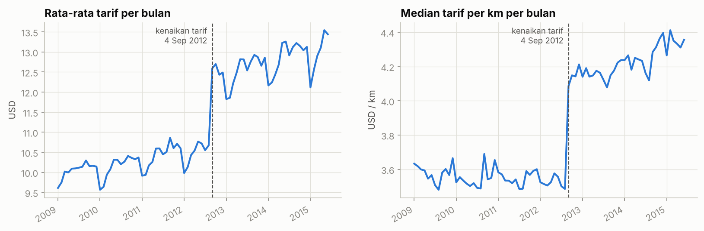

Grafik bulanan memperlihatkan **lompatan tajam pada 4 September 2012**, saat TLC menaikkan tarif resmi: median
tarif per km naik dari ±3,55 menjadi ±4,15 USD/km (≈ +17%) dalam satu bulan. Rata-rata tarif tahunan naik dari
10,05 USD (2009) ke 11,15 USD (2012), lalu melonjak ke 12,55 USD (2013), sementara rata-rata jarak hanya naik
tipis (3,22 → 3,39 km). Artinya **tanggal perjalanan** wajib menjadi fitur (`year_frac`, `after_fare_hike`),
karena perjalanan dengan jarak sama bertarif berbeda sebelum dan sesudah 2012.

| Tahun | Jumlah perjalanan | Rata-rata tarif (USD) | Rata-rata jarak (km) |
|---|---:|---:|---:|
| 2009 | 8.431.912 | 10,05 | 3,22 |
| 2010 | 8.167.357 | 10,16 | 3,24 |
| 2011 | 8.489.538 | 10,44 | 3,30 |
| 2012 | 8.629.740 | 11,15 | 3,37 |
| 2013 | 8.478.884 | 12,55 | 3,39 |
| 2014 | 8.071.658 | 12,88 | 3,41 |
| 2015 (Jan–Jun) | 3.779.155 | 12,95 | 3,40 |

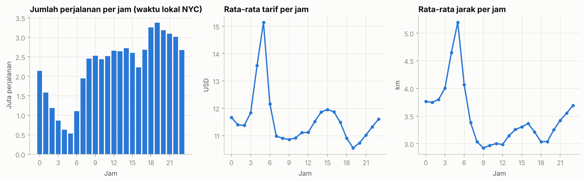

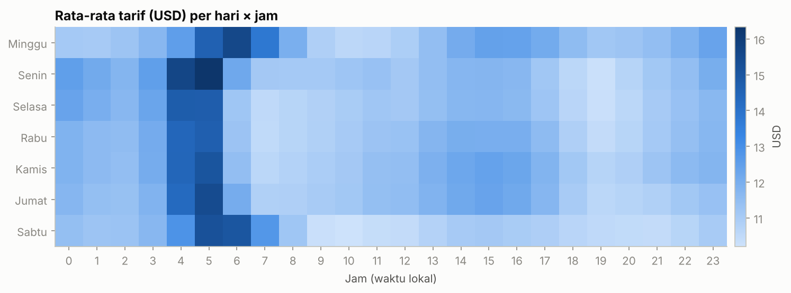

Perjalanan paling sedikit terjadi pukul 05.00 dan paling banyak pukul 18.00–20.00. Menariknya, **rata-rata tarif
dan jarak justru tertinggi pukul 05.00** (±15 USD, ±5 km): pada dini hari porsi perjalanan jauh ke/dari bandara
jauh lebih besar. *Heatmap* hari × jam menunjukkan puncak ini terjadi pukul 04–05 pada hari kerja dan bergeser
ke 05–07 pada Sabtu–Minggu. Tarif rata-rata terendah ada pada jam pulang kerja (18.00–19.00), saat banyak
perjalanan pendek di dalam Manhattan. Pola non-linear ini menjadi alasan `hour` di-*one-hot* untuk regresi
linear.

### Jumlah penumpang

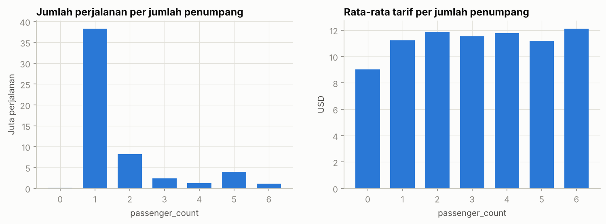

69,2% perjalanan hanya berisi 1 penumpang. Rata-rata tarif untuk 1–6 penumpang hampir sama (11,2–12,1 USD),
sesuai aturan tarif NYC yang tidak bergantung pada jumlah penumpang, sehingga `passenger_count` diperkirakan
bukan fitur penting. Nilai 0 penumpang (195 ribu baris) dan > 6 penumpang (hingga 208) adalah salah input.

### Jarak dan tarif

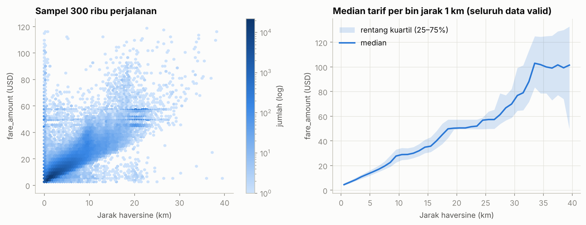

Jarak garis lurus (*haversine*) berkorelasi kuat dengan tarif (Pearson ±0,83 pada sampel 300 ribu baris).
Hubungannya hampir linear sampai ±20 km (median naik ±2,5 USD per km), lalu melebar: perjalanan jauh dipengaruhi
tol, rute, dan tarif flat. Pada *hexbin* terlihat garis-garis horizontal di 45–58 USD (tarif flat JFK untuk
berbagai jarak) dan kolom vertikal di jarak ±0 km dengan tarif beragam. Ada **803.825 perjalanan dengan jarak
< 50 m** yang tetap bertarif; tarifnya tidak dapat dijelaskan oleh lokasi sehingga dibuang pada tahap
pembersihan.

### Sebaran geografis dan perjalanan bandara

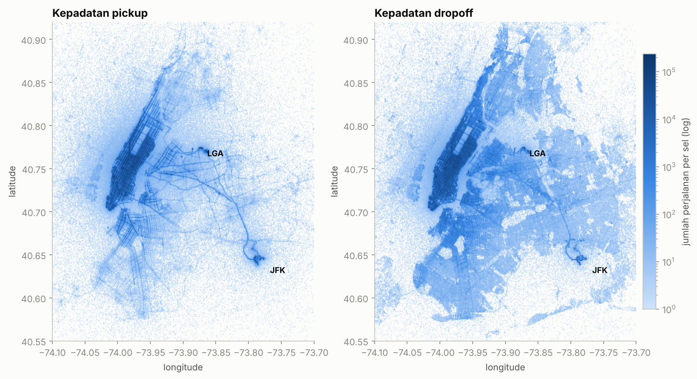

Peta dibuat dengan *binning* 2D di Spark (sel ±0,001° ≈ 100 m): hanya jumlah perjalanan per sel yang dibawa ke
driver, bukan puluhan juta titik. Penjemputan sangat terpusat di Manhattan (pola jalan grid terlihat jelas),
sedangkan pengantaran lebih menyebar ke Brooklyn dan Queens. Bandara JFK dan LaGuardia tampak sebagai titik
padat. Perjalanan yang menyentuh bandara (radius 2 km) hanya ±5,5% data, tetapi rata-rata tarifnya 3–7 kali
lipat perjalanan biasa:

| Jenis perjalanan | Jumlah | % | Rata-rata tarif (USD) | Median tarif (USD) | Rata-rata jarak (km) |
|---|---:|---:|---:|---:|---:|
| Non-bandara | 51.080.266 | 94,51 | 9,80 | 8,10 | 2,77 |
| LaGuardia (LGA) | 1.760.890 | 3,26 | 30,62 | 30,67 | 9,58 |
| JFK | 1.136.171 | 2,10 | 45,91 | 49,80 | 17,91 |
| Newark (EWR) | 70.917 | 0,13 | 70,26 | 70,69 | 16,43 |

Perjalanan Newark lebih mahal daripada JFK walau jaraknya lebih pendek, karena perjalanan ke Newark (New Jersey)
dikenai *surcharge* khusus Newark dan tol di atas tarif argometer. Temuan ini mendasari fitur jarak ke tiap
bandara.

## 4.3 Transformasi data / preprocessing (poin 3)

### Pembersihan data

| Aturan | Alasan | Baris dibuang | % dari awal |
|---|---|---:|---:|
| R1 tidak ada null | koordinat tujuan kosong tidak bisa dipakai | 376 | 0,0007 |
| R2 2,5 ≤ `fare_amount` ≤ 250 | tarif awal minimal USD 2,50; > 250 sangat langka dan mayoritas salah input | 5.453 | 0,0098 |
| R3 1 ≤ `passenger_count` ≤ 6 | kapasitas taksi; 0 penumpang = salah input | 195.108 | 0,3520 |
| R4 pickup & dropoff di area NYC | koordinat 0 atau di luar kota = error GPS | 1.174.675 | 2,1194 |
| R5 0,05 km ≤ jarak ≤ 100 km | jarak ±0 tidak menjelaskan tarif; > 100 km mustahil di dalam kotak NYC | 805.629 | 1,4536 |
| R6 hapus duplikat persis | duplikasi membuat bobot sampel tidak seimbang | 32 | 0,0001 |
| **Total dibuang** | | **2.181.273** | **3,9356** |
| **Sisa (data bersih)** | | **53.242.583** | **96,0644** |

Aturan diterapkan berurutan, dan jumlah baris yang **pertama kali** gugur pada tiap aturan dihitung dalam satu
scan (karena itu angkanya lebih kecil daripada audit di 4.2 yang saling tumpang tindih). Penyumbang terbesar
adalah koordinat di luar NYC (1,17 juta) dan jarak < 50 m (0,81 juta). Filter, `dropDuplicates` (shuffle 53 juta
baris), pembagian train/test, dan penulisan `clean.parquet` (2,05 GB) selesai dalam ±49 detik.

Fitur-fitur di bawah **tidak ditulis ulang ke disk**: `add_features` hanya menambahkan ekspresi pada rencana
eksekusi (*lazy*), dan Spark menghitungnya ulang saat data dibaca. Menghitung ±20 ekspresi trigonometri jauh
lebih murah daripada membaca ulang tabel fitur selebar 37 kolom (±7,7 GB), dan menghemat ruang disk.

### Rekayasa fitur

Model hanya menerima vektor numerik, padahal informasi penting tersembunyi di timestamp dan pasangan koordinat.
Dibangun 28 fitur (ditambah 1 fitur interaksi khusus regresi linear) memakai fungsi bawaan Spark SQL:

| Kelompok | Fitur | Alasan |
|---|---|---|
| Waktu | `year`, `month`, `day_of_week`, `hour`, `year_frac` | inflasi & kenaikan tarif, pola mingguan & harian |
| Flag waktu | `is_weekend`, `is_night` (20.00–06.00), `is_peak` (16.00–20.00 hari kerja), `after_fare_hike` (≥ 4 Sep 2012) | surcharge malam USD 0,50, surcharge jam sibuk USD 1, kenaikan tarif resmi |
| Jarak | `distance_km` (haversine), `manhattan_km`, `delta_lon`, `delta_lat`, `bearing` | argometer menghitung jarak di jalan berpola grid |
| Lokasi | 4 koordinat; jarak pickup & dropoff ke JFK, LGA, EWR, dan Midtown (Times Square); `airport_trip` | tarif flat/surcharge bandara, kepadatan pusat kota |
| Lain | `passenger_count` | — |
| Interaksi (LR) | `dist_x_hike = distance_km × after_fare_hike` | tarif per km berubah setelah Sep 2012 |

### Korelasi

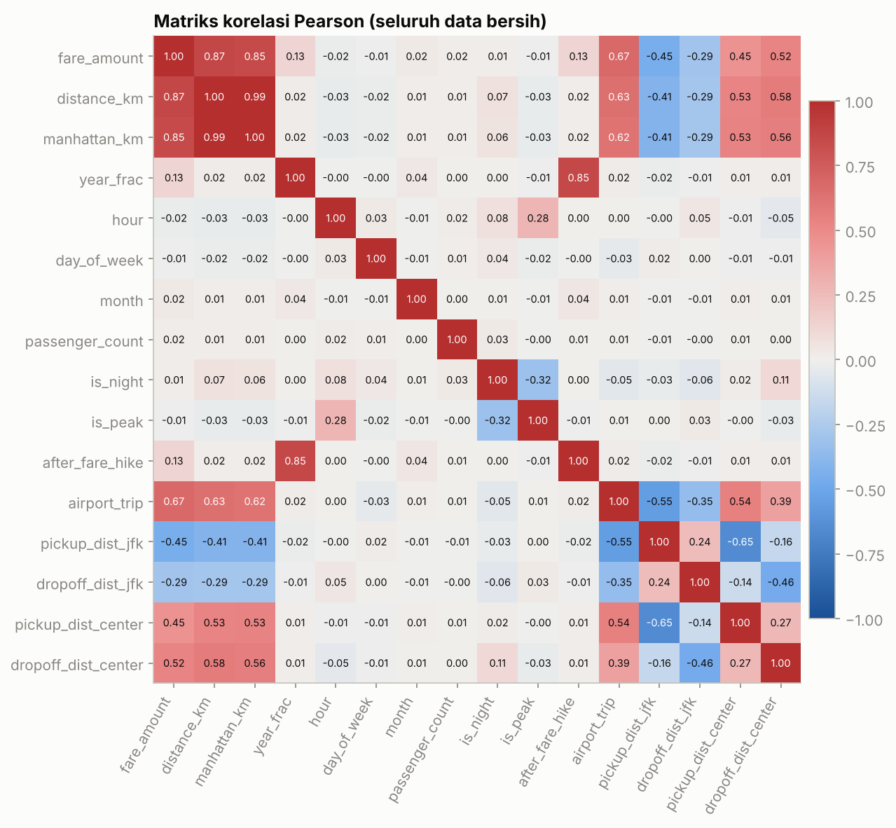

Matriks 16×16 dihitung dengan `pyspark.ml.stat.Correlation` atas 53,2 juta baris dalam ±62 detik (satu pass
`treeAggregate`). Upaya pertama memakai 120 agregat `F.corr` dalam satu query ternyata sangat lambat
(diperkirakan > 1 jam); versi MLlib jauh lebih efisien. Korelasi terhadap `fare_amount`:

| Fitur | Korelasi | | Fitur | Korelasi |
|---|---:|---|---|---:|
| `distance_km` | 0,867 | | `after_fare_hike` | 0,132 |
| `manhattan_km` | 0,850 | | `year_frac` | 0,125 |
| `airport_trip` | 0,672 | | `month` | 0,025 |
| `dropoff_dist_center` | 0,525 | | `hour` | −0,017 |
| `pickup_dist_center` | 0,450 | | `passenger_count` | 0,015 |
| `pickup_dist_jfk` | −0,446 | | `day_of_week` | −0,011 |
| `dropoff_dist_jfk` | −0,289 | | `is_peak` / `is_night` | −0,010 / 0,010 |

Jarak dan fitur bandara berkorelasi paling kuat. Fitur waktu tampak lemah secara linear, tetapi efeknya
non-linear (lonjakan 2012, puncak dini hari) sehingga tetap dipertahankan. `distance_km` dan `manhattan_km`
hampir kolinear (0,99): aman untuk model pohon, sedangkan regresi linear memakai regularisasi elastic-net.

### Pembagian data dan pipeline

Data bersih dibagi **80% latih (42.592.531 baris) dan 20% uji (10.650.052 baris)** dengan `F.rand(seed=42)`.
Kolom pembagi langsung ditulis sebagai partisi folder `clean.parquet/split=train|test` sehingga pembagian bersifat
permanen dan murah dibaca ulang — `randomSplit` harus mengurutkan ulang setiap partisi pada setiap pembacaan
agar deterministik, yang mahal untuk 53 juta baris.

Transformasi untuk model dibungkus `pyspark.ml.Pipeline`:

* **Model pohon** (Decision Tree, Random Forest, GBT): `VectorAssembler` atas 28 fitur — pohon tidak sensitif
  terhadap skala dan dapat memotong variabel waktu/lokasi secara non-linear.
* **Regresi linear**: `OneHotEncoder` untuk `hour`, `day_of_week`, `month`, `year` (efeknya tidak linear),
  `StandardScaler` untuk fitur numerik, ditambah fitur interaksi `dist_x_hike`.

## 4.4 Pemodelan dengan PySpark MLlib (poin 4)

Empat algoritma regresi MLlib dibandingkan, ditambah *baseline* yang selalu menebak rata-rata tarif:

| Model | Konfigurasi | Alasan dipilih |
|---|---|---|
| Linear Regression | elastic-net, `regParam=0.01`, `elasticNetParam=0.1` | baseline yang mudah ditafsirkan |
| Decision Tree | `maxDepth=10`, `maxBins=64` | menangkap non-linearitas (mis. tarif flat bandara) |
| Random Forest | 40 pohon, `maxDepth=10`, `subsamplingRate=0.8` | *bagging* → varians lebih rendah |
| GBT | 60 iterasi, `maxDepth=6`, `stepSize=0.1`, `subsamplingRate=0.8` | *boosting*, umumnya terbaik untuk data tabular |

**Strategi skala data.** Seluruh ETL, EDA, dan evaluasi memakai data penuh. Karena dijalankan di satu mesin
(4 core), pelatihan memakai strategi bertingkat: keempat algoritma dibandingkan pada sampel acak yang sama
sebesar ±2 juta (1.998.131) baris; *cross-validation* memakai 300.690 baris; model final hasil tuning dilatih ulang
pada ±8 juta baris. Algoritma pohon MLlib menjalankan satu *job* Spark untuk setiap level pohon, sehingga
sampel ±2 juta dan 300 ribu baris dipadatkan ke 8 partisi (`repartition`) agar overhead
penjadwalan *task* kecil.

Waktu pelatihan pada ±2 juta (1.998.131) baris:

| Model | Waktu latih |
|---|---:|
| Linear Regression | 13 detik |
| Decision Tree | 10 detik |
| Random Forest | 103 detik |
| GBT | 127 detik |

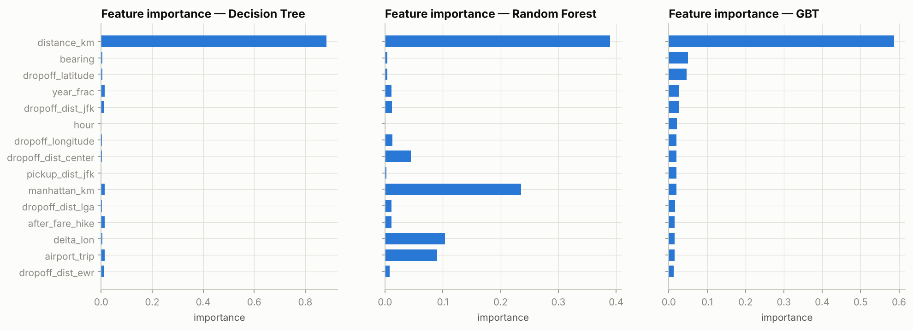

Ketiga model pohon sepakat bahwa **jarak** adalah fitur terpenting (importance 0,88 pada Decision Tree, 0,39 pada
Random Forest, 0,59 pada GBT). Random Forest membagi kepentingan ke fitur jarak lain yang saling berkorelasi
(`manhattan_km` 0,24, `delta_lon`, `airport_trip`), sedangkan GBT, yang membangun pohon bertahap untuk
memperbaiki residual, memanfaatkan lebih banyak fitur sekunder: arah perjalanan (`bearing`), lokasi tujuan,
jarak ke JFK, dan waktu (`year_frac`, `hour`).

Pada regresi linear (fitur distandardisasi), koefisien terbesar adalah `distance_km` (+8,90 USD per simpangan
baku), `pickup_dist_jfk` (−3,20: makin dekat ke JFK makin mahal), dan interaksi `dist_x_hike` (+1,78: tarif per km
lebih mahal setelah September 2012).

## 4.5 Evaluasi model (poin 5)

Metrik yang dipakai:

* **RMSE** = √( Σ(ŷ − y)² / n ): dalam USD, menghukum kesalahan besar lebih berat; metrik resmi kompetisi.
* **MAE** = Σ|ŷ − y| / n: rata-rata selisih absolut dalam USD, lebih tahan *outlier*.
* **R²** = 1 − Σ(ŷ − y)² / Σ(y − ȳ)²: proporsi variasi tarif yang dijelaskan model (1 = sempurna, 0 = setara
  menebak rata-rata).

(ŷ = prediksi, y = tarif aktual, ȳ = rata-rata tarif aktual, n = jumlah baris.)

Ketiganya dihitung pada **seluruh 10.650.052 baris data uji** dalam satu scan per model (fungsi
`regression_metrics`); hasilnya diverifikasi sama dengan `RegressionEvaluator` bawaan MLlib
(RMSE GBT 3,1701 dari kedua cara).

| Model | RMSE uji (USD) | MAE uji (USD) | R² uji | RMSE latih (USD) |
|---|---:|---:|---:|---:|
| Baseline (rata-rata) | 9,411 | 5,916 | 0,000 | — |
| Linear Regression | 3,814 | 1,955 | 0,836 | 3,826 |
| Decision Tree | 3,420 | 1,759 | 0,868 | 3,276 |
| Random Forest | 3,308 | 1,732 | 0,876 | 3,226 |
| **GBT** | **3,170** | **1,573** | **0,887** | 3,070 |

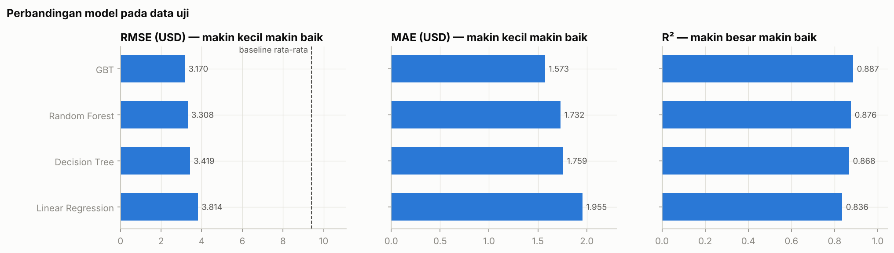

* Semua model jauh lebih baik daripada baseline: RMSE turun dari 9,41 menjadi 3,17–3,81 USD.
* **GBT terbaik** pada ketiga metrik: rata-rata meleset ±1,57 USD (MAE) dan menjelaskan 88,7% variasi tarif.
  Model pohon unggul karena struktur tarif yang non-linear (tarif flat bandara, surcharge berdasarkan jam,
  lonjakan tarif 2012).
* **Overfitting kecil**: selisih RMSE latih vs uji hanya 0,08–0,14 USD untuk model pohon. Linear Regression justru
  sedikit lebih baik di data uji, tanda model terlalu sederhana (*underfit*), bukan *overfit*.
* Evaluasi seluruh model atas 10,65 juta baris uji (termasuk inferensi) memakan ±3 menit.

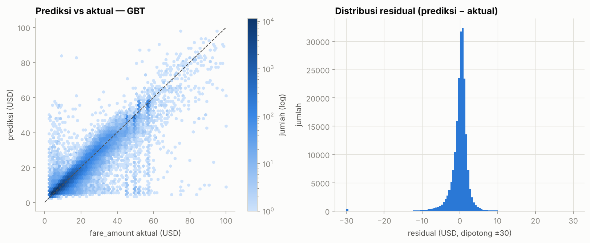

Residual GBT terpusat di sekitar nol (median +0,33 USD); 79,0% prediksi meleset < 2 USD dan 95,6% < 5 USD. Pada
plot prediksi vs aktual terlihat garis vertikal di 45–58 USD: tarif flat bandara yang nilainya tetap walaupun
jaraknya berbeda. Galat membesar seiring jarak perjalanan:

| Jarak | Jumlah baris uji | RMSE (USD) | MAE (USD) | Rata-rata tarif (USD) |
|---|---:|---:|---:|---:|
| 0–2 km | 4.856.813 | 2,60 | 1,16 | 6,36 |
| 2–5 km | 3.898.189 | 2,61 | 1,48 | 10,62 |
| 5–10 km | 1.351.923 | 3,84 | 2,36 | 19,48 |
| 10–20 km | 413.651 | 6,50 | 4,07 | 35,96 |
| ≥ 20 km | 129.476 | 8,92 | 3,65 | 52,87 |

82% perjalanan uji berjarak < 5 km dan diprediksi dengan RMSE ±2,6 USD. Perjalanan jauh lebih sulit karena tol,
pilihan rute, dan kemacetan tidak terlihat dari koordinat; relatif terhadap tarifnya, galat perjalanan ≥ 20 km
(MAE 3,65 dari rata-rata 52,87 USD ≈ 7%) justru lebih kecil daripada perjalanan pendek (1,16 dari 6,36 ≈ 18%).

## 4.6 Hyperparameter tuning (poin 6)

GBT (model terbaik di Bagian 4.5) dituning dengan `CrossValidator` (3-fold) dan `ParamGridBuilder`, metrik
seleksi RMSE:

| Hyperparameter | Nilai dicoba | Peran |
|---|---|---|
| `maxDepth` | 6, 9 | kedalaman pohon → kompleksitas interaksi fitur |
| `maxIter` | 50, 100 | jumlah pohon *boosting* |
| `stepSize` | 0,1; 0,2 | *learning rate* |

Total 8 kombinasi × 3 fold = 24 model, dilatih pada 300.690 baris data **latih** (data uji tidak disentuh)
dalam ±23 menit.

> **Pelajaran teknis.** Percobaan awal memakai `CrossValidator(parallelism=2)` agar dua model dilatih bersamaan.
> Ternyata di PySpark, *thread pool* Python yang dipakai untuk paralelisme ini menahan referensi ke ribuan
> *shuffle* kecil yang dihasilkan GBT (satu job Spark per level pohon), sehingga `ContextCleaner` tidak pernah
> menghapus filenya. Direktori sementara Spark membengkak hingga >14 GB dan proses gagal dengan
> `No space left on device`. Hal ini dibuktikan dengan eksperimen kecil: setelah GC, `parallelism=2`
> menyisakan 356 file shuffle, sedangkan `parallelism=1` hanya 16 (shuffle data input yang memang masih
> dipakai). Konfigurasi final memakai `parallelism=1` dan `spark.cleaner.periodicGC.interval=1min`; paralelisme
> tetap terjadi di dalam setiap job (4 core memproses partisi secara paralel).

| Peringkat | `maxDepth` | `maxIter` | `stepSize` | RMSE CV (USD) | Simpangan baku |
|---:|---:|---:|---:|---:|---:|
| 1 | **6** | **100** | **0,1** | **3,223** | 0,130 |
| 2 | 6 | 50 | 0,1 | 3,270 | 0,129 |
| 3 | 6 | 50 | 0,2 | 3,291 | 0,128 |
| 4 | 6 | 100 | 0,2 | 3,299 | 0,123 |
| 5 | 9 | 50 | 0,1 | 3,499 | 0,101 |
| 6 | 9 | 100 | 0,1 | 3,502 | 0,099 |
| 7 | 9 | 50 | 0,2 | 3,668 | 0,064 |
| 8 | 9 | 100 | 0,2 | 3,728 | 0,063 |

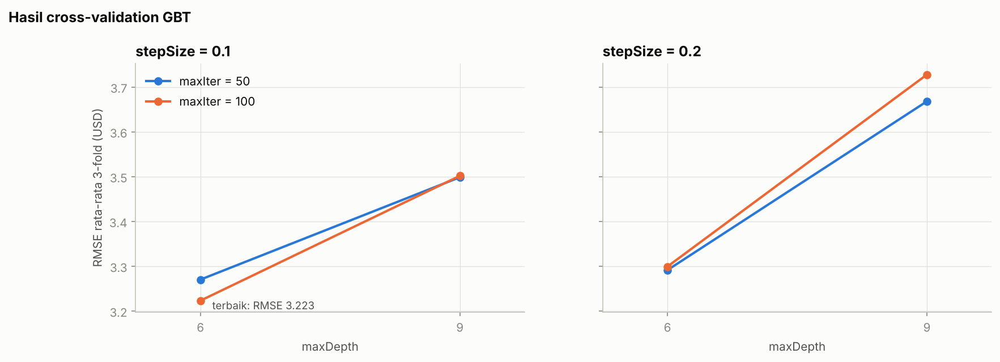

* Konfigurasi terbaik adalah `maxDepth=6, maxIter=100, stepSize=0.1`.
* **Pohon lebih dalam (`maxDepth=9`) justru lebih buruk** (RMSE 3,50–3,73). Dengan ±200 ribu baris latih per
  fold, pohon 9 level (hingga 512 daun) mulai menghafal *noise*; kombinasi pohon dalam dan *learning rate* 0,2
  paling *overfit*.
* Untuk `maxDepth=6`, menambah pohon dari 50 ke 100 membantu pada `stepSize=0.1` (3,270 → 3,223) tetapi tidak
  pada `stepSize=0.2` (3,291 → 3,299): *learning rate* besar konvergen lebih cepat sehingga pohon tambahan mulai
  *overfit*.

Konfigurasi terbaik lalu dilatih ulang dan dibandingkan dengan GBT awal pada data uji yang sama (10,65 juta baris).
Untuk memisahkan efek tuning dari efek jumlah data, konfigurasi terbaik juga dilatih pada sampel ±2 juta baris
yang sama dengan Bagian 4.4:

| Model | Data latih | RMSE (USD) | MAE (USD) | R² | Perbaikan RMSE |
|---|---:|---:|---:|---:|---:|
| GBT awal (depth 6, 60 iterasi, step 0,1) | ±2 juta | 3,170 | 1,573 | 0,887 | — |
| GBT hasil tuning | ±2 juta | 3,110 | 1,525 | 0,891 | −1,9% |
| **GBT hasil tuning (model final)** | **±8 juta** | **3,088** | **1,516** | **0,892** | **−2,6%** |

Tuning menurunkan RMSE 1,9% pada data latih yang sama, dan pelatihan ulang dengan ±8 juta baris (±11 menit)
menurunkannya lagi menjadi **3,088 USD**. Tambahan data dari 2 ke 8 juta baris hanya memberi perbaikan 0,7%,
lebih kecil daripada efek tuning: kurva belajar mulai landai, sehingga keterbatasan model kini lebih terletak pada
informasi yang tersedia (fitur) daripada jumlah data.

Contoh prediksi model final untuk perjalanan hipotetis:

| Perjalanan | Jarak (km) | Prediksi (USD) |
|---|---:|---:|
| Times Square → JFK, Rabu 17.30 (2015) | 21,77 | 57,68 |
| Times Square → JFK, Rabu 17.30 (2011, sebelum kenaikan tarif) | 21,77 | 49,37 |
| Times Square → Grand Central, Sabtu 23.10 (2015) | 0,91 | 6,21 |
| LaGuardia → Times Square, Rabu 09.00 (2015) | 9,62 | 44,35 |

Prediksi Times Square → JFK pada jam sibuk 2015 (57,68 USD) mendekati tarif flat JFK 52 USD + surcharge jam sibuk
4,50 USD, dan perjalanan yang sama pada 2011 diprediksi ±8 USD lebih murah, sejalan dengan kenaikan tarif flat
2012 (45 → 52 USD). Model final disimpan di `models/gbt_tuned_final` dan dapat dimuat ulang dengan
`PipelineModel.load(...)`.

# 5. Pembahasan

**Mengapa GBT unggul.** Tarif taksi NYC adalah fungsi bertingkat: tarif dasar per jarak, ditambah aturan
diskrit (tarif flat JFK, surcharge malam/jam sibuk, kenaikan tarif 2012) yang hanya berlaku pada wilayah atau
waktu tertentu. Model pohon dapat memotong ruang fitur menjadi wilayah-wilayah tersebut, sedangkan regresi linear
hanya mampu mendekatinya lewat fitur interaksi buatan tangan. GBT menambahkan pohon satu per satu untuk
memperbaiki residual sehingga dapat memodelkan aturan-aturan kecil yang tertinggal oleh pohon sebelumnya.

**Pengaruh *feature engineering*.** Fitur terpenting di semua model adalah fitur turunan: jarak *haversine*,
yang dihitung dari empat kolom koordinat, berkorelasi 0,87 dengan tarif. Jarak ke JFK dan `after_fare_hike`
termasuk 10 fitur terpenting GBT final, sedangkan `pickup_dist_jfk` dan `dist_x_hike` termasuk koefisien terbesar
regresi linear.

**Pelajaran *big data* dari pengerjaan.**

1. *Audit dulu, baru modelkan.* ±4% data kotor dan label zona waktu yang keliru akan merusak fitur jam bila tidak
   diperiksa.
2. *Cara menulis query sangat menentukan.* 120 agregat `F.corr` dalam satu query diperkirakan > 1 jam, sedangkan
   `Correlation.corr` MLlib selesai dalam 1 menit. `randomSplit` diganti kolom split yang ditulis sebagai partisi
   Parquet agar tidak perlu mengurutkan ulang data di setiap pembacaan.
3. *Sumber daya disk ikut menentukan.* Menyimpan tabel fitur 37 kolom memakan 7,7 GB, dan `CrossValidator` dengan
   `parallelism=2` menahan ribuan file *shuffle* GBT hingga disk penuh. Solusinya fitur dihitung *lazy*, CV memakai
   `parallelism=1`, dan GC berkala diaktifkan agar `ContextCleaner` membersihkan *shuffle* lama.
4. *Algoritma pohon MLlib menjalankan satu job per level pohon.* Untuk sampel kecil, mengurangi jumlah partisi
   (`repartition(8)`) menurunkan overhead penjadwalan.

**Keterbatasan.**

* Model dilatih pada sampel (±2 juta, 300 ribu, dan ±8 juta baris), bukan 100% data latih, karena keterbatasan satu
  mesin 4 core; ETL, EDA, dan evaluasi tetap memakai data penuh. Kurva belajar (2 → 8 juta baris hanya −0,7%
  RMSE) menunjukkan tambahan data memberi manfaat yang semakin kecil.
* Tuning dilakukan pada 300 ribu baris. Pada ukuran ini pohon dalam cenderung *overfit*; dengan data yang jauh
  lebih besar, `maxDepth` yang lebih besar mungkin justru lebih baik. Grid yang dicoba juga terbatas (8
  kombinasi).
* Jarak *haversine* adalah jarak garis lurus, bukan jarak tempuh jalan. Tol, kemacetan, dan waktu tempuh tidak
  tersedia di data, sehingga galat perjalanan jauh tetap besar.
* Evaluasi memakai *hold-out* dari `train.csv` yang sudah dibersihkan. Pada data Kaggle `test.csv` (tanpa label),
  baris ekstrem yang di sini dibuang tetap harus diprediksi.

**Pengembangan selanjutnya.** Gunakan jarak rute jalan (mis. OSRM/OpenStreetMap), tambahkan data cuaca dan hari
libur, kelompokkan lokasi ke zona taksi TLC, latih pada 100% data di klaster Spark multi-node, dan perluas grid
tuning (`minInstancesPerNode`, `subsamplingRate`, `maxBins`) pada sampel yang lebih besar.

# 6. Kesimpulan

1. Seluruh 55,4 juta baris dataset NYC Taxi Fare berhasil dimuat, diaudit, dibersihkan, dan diubah menjadi fitur
   **menggunakan PySpark** tanpa memindahkan data mentah ke memori Python. ETL, EDA, dan *preprocessing* selesai
   dalam ±7 menit pada satu mesin 4 core.
2. EDA menemukan ±4% data kotor, label zona waktu yang menyesatkan, kenaikan tarif resmi 4 September 2012, serta
   peran besar tarif flat bandara. Setelah pembersihan tersisa **53.242.583 baris (96,06%)**.
3. *Feature engineering* menghasilkan 28 fitur. **Jarak** adalah prediktor utama, tetapi fitur waktu dan lokasi
   (jarak ke bandara dan pusat kota) menambah akurasi yang berarti.
4. Dari empat algoritma Spark MLlib, **Gradient-Boosted Trees** paling akurat (RMSE uji 3,170 USD), diikuti Random
   Forest (3,308), Decision Tree (3,420), dan Linear Regression (3,814); baseline rata-rata 9,411.
5. *Hyperparameter tuning* dengan `CrossValidator` 3-fold memilih `maxDepth=6, maxIter=100, stepSize=0.1`.
   Model final yang dilatih dengan ±8 juta baris mencapai **RMSE 3,088 USD, MAE 1,516 USD, dan R² 0,892** pada
   10.650.052 baris data uji, perbaikan 2,6% dari GBT awal dan 67% dari baseline.

# Lampiran

## A. Struktur repositori

| Lokasi | Isi |
|---|---|
| `notebooks/nyc_taxi_fare_pyspark.ipynb` | notebook utama, sudah dieksekusi lengkap dengan output |
| `laporan/` | laporan ini (`.md`, `.docx`, `.pdf`) |
| `figures/` | 12 grafik hasil EDA dan evaluasi |
| `results/` | `metrics.json`, `model_comparison.csv`, `cv_results.csv` |
| `models/gbt_tuned_final/` | model final (Spark `PipelineModel`) |
| `scripts/download_data.sh` | unduh dataset (mirror Parquet atau Kaggle) |
| `scripts/build_laporan.py` | bangun `.docx`/`.pdf` dari laporan `.md` |
| `requirements.txt` | dependensi Python |

## B. Cara menjalankan

Butuh Python 3.10+ dan Java 17/21.

```bash
pip install -r requirements.txt
bash scripts/download_data.sh      # ±3,8 GB ke data/raw/
cd notebooks
jupyter notebook nyc_taxi_fare_pyspark.ipynb
```

## C. Waktu eksekusi tiap tahap (data penuh, 4 core)

| Tahap | Waktu |
|---|---:|
| Baca data + hitung baris | 6 detik |
| Konversi tipe + tulis `prepared.parquet` | 52 detik |
| Statistik deskriptif (`summary`) | 51 detik |
| Audit anomali (satu scan) | 4 detik |
| Agregasi EDA (distribusi, temporal, jarak, peta, bandara) | ±1,9 menit |
| Pembersihan + deduplikasi + tulis `clean.parquet` | 49 detik |
| Matriks korelasi 16×16 | 62 detik |
| Latih 4 model (±2 juta baris) | ±4,2 menit |
| Evaluasi 4 model + baseline (10,65 juta baris uji) | ±3 menit |
| Analisis galat model terbaik | 55 detik |
| Cross-validation GBT (24 model, 300 ribu baris) | ±23 menit |
| Latih GBT final (±8 juta baris) | ±11 menit |
| Latih GBT hasil tuning pada ±2 juta baris (pembanding) | ±3 menit |
| **Total notebook** | **±53 menit** |

## D. Pembagian kerja kelompok

| Anggota | Kontribusi |
|---|---|
| _Nama Anggota 1 (NIM)_ | _diisi kelompok_ |
| _Nama Anggota 2 (NIM)_ | _diisi kelompok_ |

## E. Referensi

1. Kaggle. *New York City Taxi Fare Prediction*. https://www.kaggle.com/competitions/new-york-city-taxi-fare-prediction
2. Apache Spark. *MLlib: Main Guide* dan *PySpark API Reference*. https://spark.apache.org/docs/latest/
3. NYC Taxi & Limousine Commission. *Taxi Fare* (struktur tarif, surcharge, tarif flat JFK). https://www.nyc.gov/site/tlc/passengers/taxi-fare.page
4. Friedman, J. H. (2001). Greedy function approximation: A gradient boosting machine. *Annals of Statistics*, 29(5).
5. Breiman, L. (2001). Random forests. *Machine Learning*, 45(1), 5–32.
